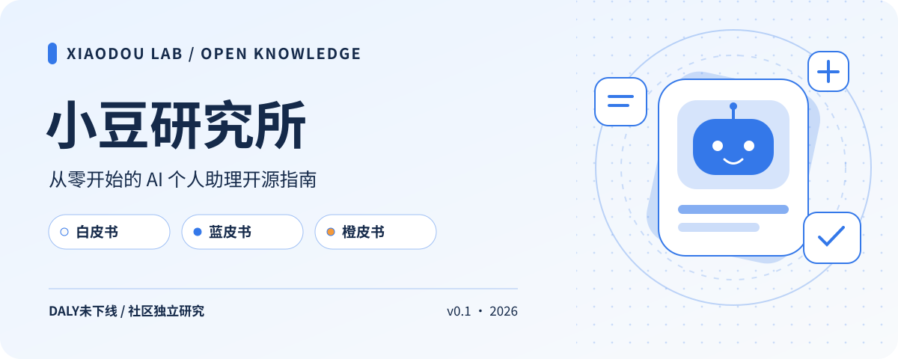
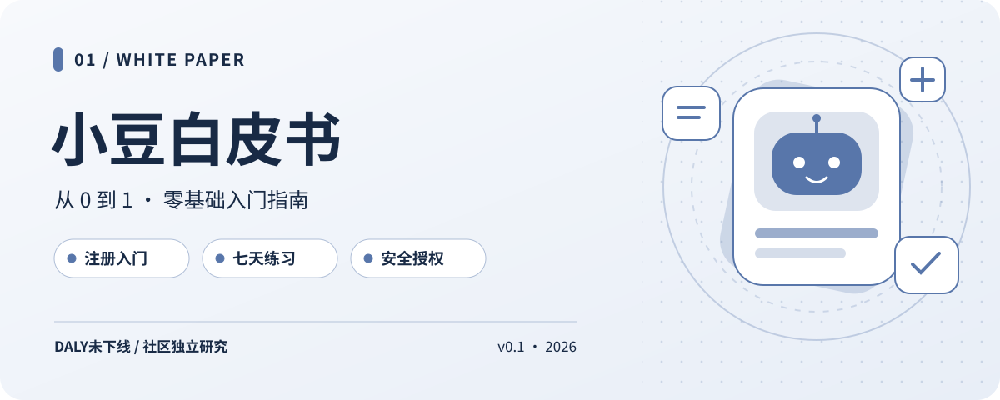
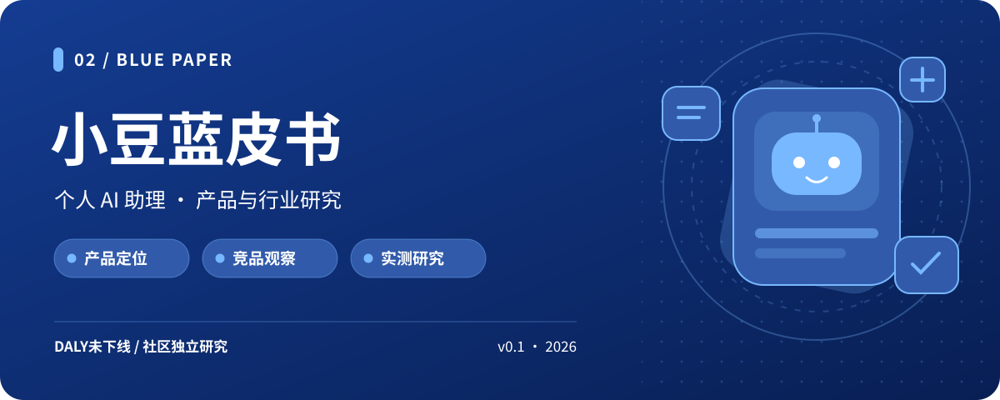
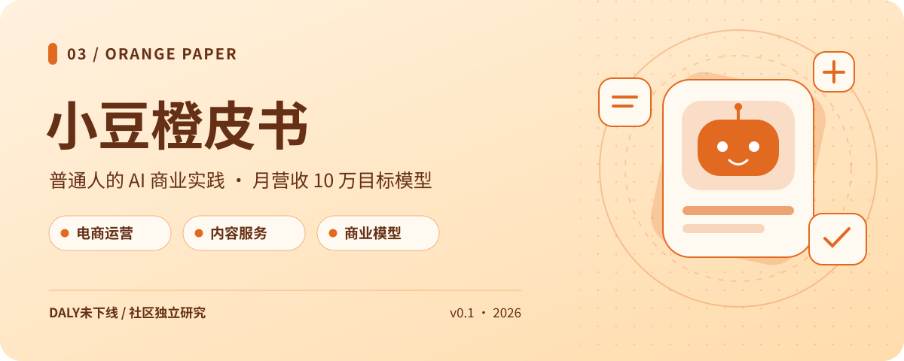

# 小豆研究所 · Xiaodou Lab

**小豆从 0 到 1｜个人 AI 助理研究｜普通人的 AI 商业实践**

由 [**Daly未下线**](https://github.com/liudali333) 发起 · 非官方独立研究 · 社区共建

[开始学习](#01--三本皮书) · [最新情报](#02--最新研究) · [实战资源](#03--实战资源) · [参与共建](#06--社区共建)

---

> **写给每一个想用好 AI 的普通人。**  
> 从认识小豆，到把 AI 融入生活和工作，再到验证可持续的商业模式。  
> 不贩卖成功学，只记录真实过程。

## 01 · 三本皮书

<table>
<tr>
<td width="33%" align="center"></td>
<td width="33%" align="center"></td>
<td width="33%" align="center"></td>
</tr>
<tr>
<td valign="top">

**白皮书 · 学会用**

零基础入门、注册配置、七天训练、记忆、任务、隐私和授权。

</td>
<td valign="top">

**蓝皮书 · 看懂 AI**

产品定位、竞品地图、行业趋势、评测协议和风险研究。

</td>
<td valign="top">

**橙皮书 · 探索变现**

电商、内容创业、AI 服务、流程自动化与月营收 10 万目标模型。

</td>
</tr>
<tr>
<td align="center"><a href="docs/white-paper/README.md"><b>阅读白皮书 →</b></a></td>
<td align="center"><a href="docs/blue-paper/README.md"><b>阅读蓝皮书 →</b></a></td>
<td align="center"><a href="docs/orange-paper/README.md"><b>阅读橙皮书 →</b></a></td>
</tr>
</table>

> 橙皮书中的月入 10 万为假设的月营业收入目标，不是实际收益、净利润或保证回报。

## 02 · 最新研究

> **2026.11.25｜公测首日深度调研**
>
> [阅读完整调研报告 →](research/2026-11-25-deep-dive.md)

| 研究专题 | 已整理的内容 |
| :--- | :--- |
| 产品动态 | 11 月 24 日邀请制公测、产品定位 |
| 下载入口 | [中国大陆 App Store](https://apps.apple.com/cn/app/id6815582077) |
| 订阅与成本 | 连续包月标准版 68 元、加强版 200 元、高级版 500 元（商店历史标价） |
| 核心能力 | 记忆、主动提醒、持续跟进、生活与办公服务 |
| 应用生态 | 媒体报道中的应用连接和插件入口 |
| 安全边界 | 数据隐私、最小授权、执行确认与撤销 |

价格与功能以实际版本和账号页面为准。媒体报道与项目独立实测分开记录。

[信息来源](research/sources.md) · [更新日志](research/changelog.md)

## 邀请码雷达 · Invite Radar

自动发现 X 上疑似公开分享的小豆邀请码，去重并保留原帖链接。候选码未经验证，不自动兑换，不提供交易服务。

- [打开邀请码雷达（Pages 部署后可访问）](https://liudali333.github.io/xiaodou-lab/invite-radar/)
- [配置与运行说明](docs/invite-radar/README.md)
- [X 实时搜索](https://x.com/search?q=%E5%B0%8F%E8%B1%86%20%E9%82%80%E8%AF%B7%E7%A0%81&f=live)

当前需配置 X API 授权并启用 GitHub Pages；尚无真实扫描结果。

## 03 · 实战资源

**拿来就用的指令和工作流。** 以下是可复用的实践模板，不代表所有任务已经在小豆上成功执行。

| 场景 | 练习内容 |
| :--- | :--- |
| 📅 个人效率 | 待办整理、日程提醒、每周复盘 |
| 🛒 电商运营 | 匿名商品数据分析、售后分类、运营周报 |
| 🎬 内容创业 | 选题策划、短视频脚本、发布复盘 |
| 🤝 AI 服务 | 客户需求梳理、交付计划、人工审核 |
| 📊 商业分析 | 回款、成本、利润、有效时薪 |

- [提示词库](examples/prompts.md)：可直接复制的指令模板
- [工作流模板](examples/workflows.md)：任务输入、操作流程、验收和失败处理
- [蓝皮书评测协议](docs/blue-paper/README.md)：用真实记录验证能力

## 04 · 从哪里开始？

| 你是谁 | 建议学习路线 |
| :--- | :--- |
| 第一次接触 AI 助理 | 白皮书 → 七天上手练习 → 提示词库 |
| AI 爱好者、开发者 | 蓝皮书 → 深度调研 → 独立实测 |
| 电商、自媒体、自由职业者 | 橙皮书 → 实战模板 → 首个付费试单 |
| 企业或团队 | 工作流模板 → 权限检查 → 低风险试点 |

先验证一个小任务，再逐步扩大使用范围。不要一开始就授权敏感账号或自动执行交易。

## 05 · 更新路线图

| 阶段 | 内容 | 状态 |
| :--- | :--- | :--- |
| v0.1 | 三本皮书、首日深度调研、提示词与工作流 | 已发布 |
| 后续 | 实机截图、功能验证、额度消耗记录 | 待实测 |
| 后续 | 电商与内容创业案例库 | 计划中 |
| 后续 | 多智能体对比、长期任务评测 | 计划中 |

本项目初版于 2026 年 11 月 25 日发布。目前以公开资料研究及待验证实践方案为主，尚未完成作者账号的完整实机测试。路线图不代表发布时间承诺。

## 06 · 社区共建

一个人的体验有限，真实的社区实践才有价值。

欢迎提交真实案例、使用技巧、功能变化、失败记录与勘误。请注明测试日期、应用版本、权限范围、实际结果及来源，并移除个人隐私信息。

[贡献指南](CONTRIBUTING.md) · [免责声明](DISCLAIMER.md) · [MIT License](LICENSE)

---

**小豆研究所 · Xiaodou Lab**

AI 实践者｜电商从业者｜[Daly未下线](https://github.com/liudali333)

独立社区项目，与小豆、豆包及其他厂商无官方隶属关系。项目自有内容采用 MIT 许可；第三方商标及素材归其权利人所有。本项目不提供邀请码交易，不承诺商业收益。

