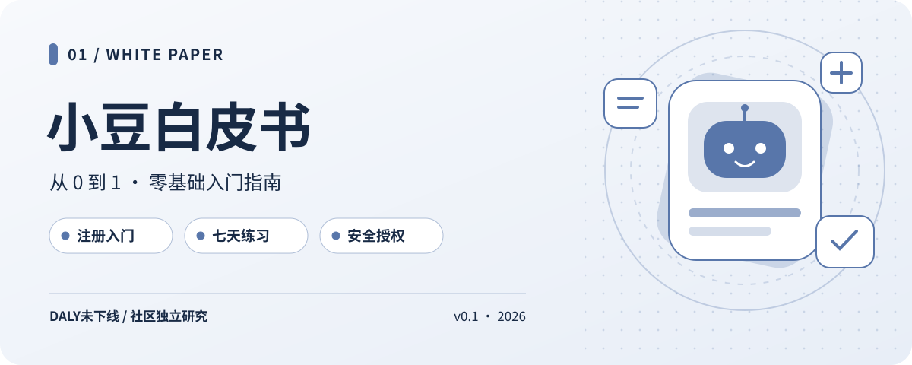

# 小豆白皮书｜从 0 到 1：零基础入门指南

版本：v0.1 · 2026-11-25 · 社区非官方教程

> 本文依据公测公告和公开报道编写，尚未进行作者账号的完整实机验证。菜单名称、权限、可用功能以当前 App 为准。

## 01｜认识小豆

小豆是豆包旗下探索个人 AI 助理的产品，于 2026 年 11 月 24 日开启邀请制公测。它的定位是结合个人上下文提供协助，并在授权下执行事务。公测邀请码可带来体验资格及一定免费额度。[来源](../../research/sources.md)

普通问答是“我问你答”，个人助理的设计目标还包括记住背景、跟进任务、在合适时机提醒。不要把设计目标等同于每项功能都已向所有账户开放。

## 02｜下载与注册

1. 在手机正规应用商店搜索“小豆”，核对开发者、应用介绍及豆包官方公告，不安装来路不明的 APK。
2. 按应用实际提示登录，核对账号及隐私协议。
3. 如页面要求邀请码，从官方允许的渠道获取；不要购买不明来源账号、共享验证码或密码。
4. 完成邀请码验证后查看实际赠送额度、消耗规则与订阅页面。不要把公测免费额度理解为无限免费。
5. 若没有邀请码，关注官方后续开放消息；本项目不提供绕过验证的方法。

iOS 上架已有媒体报道；安卓可用渠道的报道不完全一致，实际商店可用性待社区实测。正式下载链接、地区限制、会员共享规则及具体收费均待核实。

## 03｜首次配置：给助理一份工作说明书

复制以下文字，替换括号中的内容：

> 我是（职业），平时主要处理（工作事项）。我的工作时间是（时间段），重要任务以（方式）提醒。回答先给结论，再给步骤；不能确认的信息请标为待核实。涉及发消息、下单、付款、删除资料或分享个人信息时，先告诉我具体操作并等待确认。

不要填写身份证号、银行卡、客户手机号、密码等非必要信息。

## 04｜七天上手训练营

| 天数 | 练习 | 验收 |
| --- | --- | --- |
| D1 | 让小豆整理一份今日待办，标注优先级 | 至少三项可执行任务 |
| D2 | 告知工作偏好，另开会话询问是否记得 | 记录记忆是否跨会话有效 |
| D3 | 设置一个十分钟后提醒 | 核对时间、时区与是否实际收到 |
| D4 | 让小豆把一段匿名工作记录整理为纪要 | 核对是否遗漏事实 |
| D5 | 在支持的情况下设置一项定期跟进 | 确认任务是否真实建立及能否暂停 |
| D6 | 仅授权一个低风险应用，测试只读查询 | 验证授权范围和撤销方法 |
| D7 | 复盘一周，统计节省时间和错误 | 决定保留或关闭哪些功能 |

上述为测试计划，不代表每项功能均已实测可用。

## 05｜从一句话到可验收任务

指令结构：目标 + 背景 + 输入 + 时间 + 输出 + 权限边界 + 验收。

示例：

> 帮我整理下面的商品售后记录（已匿名），每天下午 5 点提醒我复查未处理事项。如果当前版本不能创建定时任务，直接告诉我。输出按问题、证据、负责人、截止时间分类，不要替我发消息或退款。

检查任务页面或系统通知是否确实出现；若未出现，不能假定它会在后台执行。任务完成后检查是否存在重复提醒和错误执行。

## 06｜记忆、连接与隐私

- 只提供与当前目标有关的信息；个人偏好与敏感数据分开。
- 如应用提供记忆管理，检查记忆内容是否正确，并测试修改、关闭及删除入口。
- 第三方应用连接采用最小授权原则；先测试读取，不随意开启写入。
- 不把客户原始订单、私人聊天、商业机密直接上传。
- 支付、合同、法律和健康事项需人工复核，不交由 AI 独立决策。
- 如无法确认数据保留或撤销机制，不授权敏感账户。

## 07｜常见问题

**没有邀请码？** 等待官方渠道开放，不参与高价倒卖。

**提醒没收到？** 检查任务是否创建、时间、系统通知权限和网络；若仍失败，改用系统日历。

**答错了怎么办？** 补充来源，让它区分事实和假设，再人工检查。

**能代替所有软件吗？** 不能。应先验证应用连接及权限，再决定是否纳入工作流。

## 08｜毕业标准

能独立发出结构化指令、检查任务是否建立、验证输出、管理授权、计算任务节省时间，并知道何时停止让 AI 执行。

下一站：[蓝皮书](../blue-paper/README.md) · [橙皮书](../orange-paper/README.md)
